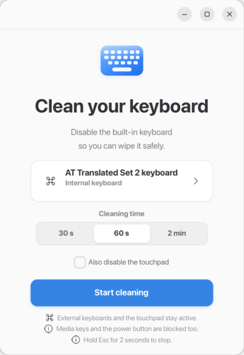
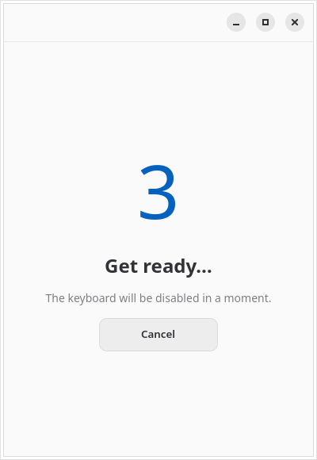
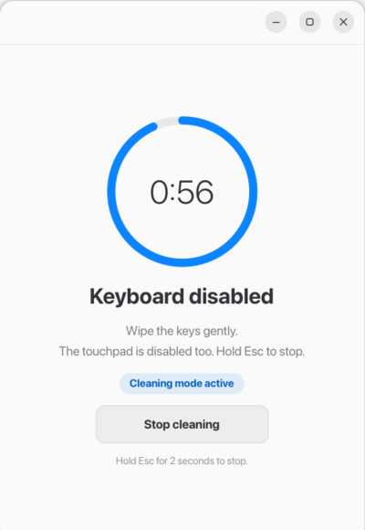
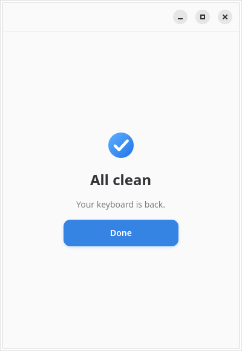

# Clean Your Lap Keyboard

Una aplicación Linux muy pequeña que desactiva temporalmente el **teclado
integrado** de un portátil para poder limpiar las teclas con el equipo
encendido. El panel táctil y los teclados externos siguen funcionando.

[English](README.md)



## Para qué sirve

Apagar el portátil para limpiar el teclado es lento y no siempre es cómodo.
Desactivar solo el teclado interno permite limpiar las teclas sin que se abran
menús, se lancen programas o se cambie la sesión por pulsaciones accidentales.

La aplicación usa `EVIOCGRAB` sobre el dispositivo evdev. Las capturas globales
de X11/Wayland no bastan, porque no impiden que el compositor o una terminal
virtual reciban las pulsaciones.

## Características

- Captura exclusiva y temporal del teclado interno.
- Captura también los dispositivos auxiliares que emiten volumen, micrófono,
  brillo y los botones de encendido y suspensión.
- Detección automática del teclado interno y selector manual.
- Ventana compacta de 400 × 580 con GTK4/libadwaita, tema claro/oscuro e idioma
  del sistema.
- Tres duraciones: 30 segundos, 60 segundos y 2 minutos.
- Cuenta atrás de tres segundos antes de capturar el teclado.
- Botón Detener y liberación manteniendo **Esc durante 2 segundos**.
- Liberación automática al terminar el tiempo, cerrar la ventana, bloquear la
  pantalla, suspender el equipo o cambiar de sesión.
- Duración máxima independiente en el helper privilegiado como segunda barrera
  de seguridad.
- Sin daemon, sin registro de teclas y sin lectura del flujo de eventos.
- Traducciones al inglés y al español.

| Cuenta atrás | Limpieza | Final |
| --- | --- | --- |
|  |  |  |

## Lo que no hace

- No desactiva el panel táctil ni un teclado externo USB/Bluetooth. Un teclado
  externo solo se ve afectado si lo seleccionas para limpiar.
- No puede bloquear teclas que el firmware o el controlador embebido gestiona
  por completo en hardware sin emitir eventos evdev.
- No lee, guarda ni transmite las pulsaciones. El helper solo captura los
  dispositivos y consulta el estado de las teclas para detectar Esc mantenido.
- No sustituye al bloqueo de pantalla. Bloquea la sesión antes de limpiar si
  hay otras personas con acceso físico al portátil.
- En Wayland no puede colocar la ventana en coordenadas absolutas; la posición
  la decide el compositor. La mayoría centra las ventanas pequeñas.

## Requisitos

- Linux con evdev (`/dev/input/event*`) y logind.
- GTK 4.8 o posterior.
- libadwaita 1.2 o posterior.
- `pkexec` y un agente de autenticación polkit en la sesión.
- Sesión de escritorio Wayland o X11.

Distribuciones objetivo:

| Distribución | Notas |
| --- | --- |
| Fedora 44 | Objetivo principal. |
| Ubuntu 24.04+ | Incluye GTK 4.8 / libadwaita 1.2. |
| Debian 12+ | Bookworm tiene las versiones necesarias. |
| Arch Linux | Los paquetes actuales son suficientes. |

## Instalación

### Fedora

Construye el RPM desde este repositorio (ver [Empaquetado](#empaquetado)) o
instala un RPM de una versión publicada:

```bash
sudo dnf install ./clean-your-lap-keyboard-0.1.1-1.fc44.x86_64.rpm
```

### Debian y Ubuntu

```bash
sudo apt install ./clean-your-lap-keyboard_0.1.1-1_amd64.deb
```

### Arch Linux

El `PKGBUILD` está en `packaging/arch/`. Cópialo junto al tarball de la versión y
ejecuta:

```bash
makepkg -si
```

La aplicación aparece en el menú como **Clean Your Lap Keyboard**. También
puedes iniciarla desde una terminal:

```bash
cylk
```

Los paquetes también instalan una página de manual:

```bash
man cylk
```

## Compilar desde el código fuente

Primero instala las dependencias de desarrollo.

### Fedora

```bash
sudo dnf install gcc meson ninja-build gettext desktop-file-utils appstream \
  gtk4-devel libadwaita-devel systemd-devel
```

### Debian / Ubuntu

```bash
sudo apt install build-essential meson ninja-build pkg-config gettext \
  desktop-file-utils appstream libgtk-4-dev libadwaita-1-dev libudev-dev \
  libglib2.0-dev
```

### Arch Linux

```bash
sudo pacman -S --needed base-devel meson ninja gettext desktop-file-utils \
  appstream gtk4 libadwaita systemd-libs
```

Después:

```bash
meson setup build --buildtype=release
meson compile -C build
meson test -C build --print-errorlogs
sudo meson install -C build
```

Para instalar en un directorio temporal sin tocar el sistema:

```bash
meson install -C build --destdir "$PWD/pkgroot"
```

Los binarios compilados también se pueden ejecutar directamente:

```bash
./build/src/cylk --list
./build/helper/cylk-helper
```

## Uso

```text
cylk [OPCIÓN…]

  -l, --list                 Muestra los teclados detectados y sale
      --list-all             Muestra teclados y dispositivos auxiliares
  -d, --device=RUTA          Usa el teclado en RUTA
      --duration=SEGUNDOS    Duración: 30, 60 o 120 segundos
      --demo=ESTADO          Previsualiza idle, countdown, cleaning o done
      --quit-after=SEGUNDOS  Cierra automáticamente (pruebas)
  -h, --help                 Muestra la ayuda
```

### Encontrar el teclado correcto

```bash
cylk --list
```

Ejemplo de salida:

```text
internal	/dev/input/event4	AT Translated Set 2 keyboard	460	i8042	platform-i8042-serio-0
external	/dev/input/event21	MOSART Semi. 2.4G Keyboard Mouse	-60	usb	pci-0000:07:00.4-usb-0:2:1.0
```

El primer campo es la clasificación heurística, seguido de la ruta del
dispositivo, el nombre, la puntuación, el bus y la ruta de hardware. La
aplicación recuerda el teclado elegido manualmente en
`~/.config/clean-your-lap-keyboard/settings.ini`.

Para ver los dispositivos auxiliares que se capturan junto al teclado
(volumen, brillo, botones de encendido), usa:

```bash
cylk --list-all
```

```text
internal	/dev/input/event4	AT Translated Set 2 keyboard	460	i8042	platform-i8042-serio-0
companion	/dev/input/event10	Video Bus	0	-	pci-0000:00:08.1
companion	/dev/input/event13	ThinkPad Extra Buttons	0	-	platform-thinkpad_acpi
external	/dev/input/event21	MOSART Semi. 2.4G Keyboard Mouse	-60	usb	pci-0000:07:00.4-usb-0:2:1.0
```

Si la elección automática no es correcta, selecciona el teclado en la tarjeta de
la aplicación o iníciala con una ruta explícita:

```bash
cylk --device /dev/input/event4 --duration 60
```

### Previsualizar la interfaz sin capturar nada

```bash
cylk --demo=idle
cylk --demo=countdown
cylk --demo=cleaning
cylk --demo=done
```

## Modelo de seguridad

El flujo normal es:

1. El usuario pulsa **Empezar limpieza**.
2. La aplicación inicia `pkexec` y pide permiso a polkit.
3. El helper abre el dispositivo evdev junto con los dispositivos auxiliares
   (volumen, micrófono, brillo, botones de encendido y suspensión), comprueba
   cada uno, espera a que se suelten todas las teclas y aplica `EVIOCGRAB` en
   todos ellos.
4. El helper baja privilegios al usuario que invocó `pkexec`, activa
   `PR_SET_NO_NEW_PRIVS` y `PR_SET_DUMPABLE=0`, y confirma el éxito.
5. La interfaz muestra la cuenta atrás y después la pantalla de limpieza.
6. El teclado se libera en cualquiera de estos casos:
   - termina la duración elegida;
   - se pulsa **Detener limpieza**;
   - se mantiene Esc durante dos segundos;
   - el helper alcanza su duración máxima (duración elegida + 5 s);
   - se cierra la ventana o la aplicación recibe `SIGTERM`/`SIGINT`;
   - se cierra la entrada estándar del helper o muere la aplicación;
   - logind informa de bloqueo de pantalla, suspensión o sesión inactiva.

Cerrar los descriptores del helper basta para que el kernel elimine el
`EVIOCGRAB`, así que el teclado se recupera incluso si la interfaz falla.
Mantener pulsado el botón de encendido durante varios segundos sigue forzando
un apagado por hardware a nivel de firmware, así que el equipo siempre se puede
apagar.

El helper **no** lee el flujo de eventos evdev. Solo usa `EVIOCGKEY` para
comprobar si hay teclas pulsadas, incluido el gesto de mantener Esc.

## Permisos y polkit

El helper se instala en el directorio `libexec` de la distribución y se lanza
bajo demanda con `pkexec`. No hay ningún daemon privilegiado permanente.

La acción polkit es:

```text
io.github.julcal008.CleanYourLapKeyboard.grab-keyboard
```

Sus valores por defecto permiten sesiones locales activas. Así se evita pedir la
contraseña cada vez. Si prefieres una autenticación más estricta, edita la
política en `/usr/share/polkit-1/actions/` o añade una regla local en
`/etc/polkit-1/rules.d/`.

El helper valida que la ruta sea un dispositivo evdev real, con los números
major/minor esperados y un mapa de capacidades de teclado completo. Cada ruta
auxiliar debe exponer teclas multimedia o de botón, no puede ser un puntero ni
un segundo teclado y debe pertenecer al mismo hardware que el teclado elegido.
Rechaza archivos arbitrarios y dispositivos no soportados.

## Solución de problemas

### `--list` no muestra el teclado interno

La detección es heurística y usa `ID_BUS`, `ID_PATH`, la ruta sysfs, el tipo de
bus y el nombre. Algunos portátiles exponen el teclado mediante un controlador
que no es i8042 o a través de un puente HID USB.

1. Ejecuta `cylk --list` y busca un dispositivo probable.
2. Ejecuta `udevadm info --query=property --name=/dev/input/eventN`.
3. Selecciona el dispositivo manualmente en la aplicación.
4. Si no aparece en la lista, comprueba que expone las letras, números, Enter,
   Espacio y Shift habituales. El helper rechaza dispositivos parciales.

### No se encuentra `pkexec` o falla la autenticación

Instala polkit y asegúrate de que hay un agente de autenticación en la sesión.
En gestores de ventanas mínimos, inicia uno como
`polkit-gnome-authentication-agent-1` o `lxpolkit`.

### `Cannot grab … Device or resource busy`

Otro programa mantiene `EVIOCGRAB` sobre el dispositivo. Cierra máquinas
virtuales, herramientas de escritorio remoto u otro software de reasignación de
teclado e inténtalo de nuevo.

### Las teclas de volumen, brillo o micrófono siguen funcionando al limpiar

Esas teclas suelen las reporta un dispositivo evdev distinto del teclado
principal, así que la aplicación también lo captura. Para ver qué dispositivos
se usan:

```bash
cylk --list-all
```

Si alguna tecla sigue funcionando, comprueba qué dispositivo la emite:

```bash
sudo evtest
```

Las teclas que gestiona el firmware por completo no se pueden bloquear desde el
espacio de usuario. Las teclas de un teclado externo se dejan funcionando a
propósito salvo que hayas seleccionado ese teclado para limpiar.

### Posición de la ventana en Wayland

Wayland no permite fijar coordenadas absolutas. El tamaño es fijo, pero el
compositor decide dónde aparece. KDE Plasma y GNOME suelen centrar las ventanas
pequeñas; otros compositores pueden no hacerlo.

### SELinux

En Fedora, instala el paquete con `dnf` para que el helper y la política reciban
las etiquetas SELinux correctas. Ejecutar binarios desde un directorio de
compilación sin etiquetar mediante `pkexec` puede quedar bloqueado. Si hace
falta, revisa:

```bash
sudo ausearch -m avc -ts recent
```

### El teclado sigue desactivado

El kernel libera la captura cuando el helper termina. Si algún proceso se queda
atascado, termínalo:

```bash
sudo pkill -TERM cylk-helper
```

Como último recurso, cambia a una terminal virtual o reinicia.

## Cómo funciona

```text
src/main.c            CLI, arranque de la aplicación y carga del CSS
src/window.c          Interfaz GTK4/libadwaita y máquina de estados
src/device.c          Detección, puntuación y dispositivos auxiliares
src/companion-keys.h  Lista compartida de teclas multimedia y de botón
src/config.c          Duración y elección manual persistidas
src/helper.c          Proceso pkexec y protocolo de líneas
src/session.c         Monitor de bloqueo, suspensión y sesión con logind
helper/cylk-helper.c  Helper privilegiado de captura y liberación
```

El protocolo del helper usa líneas:

```text
UI -> helper:  GRAB\t<ruta>\t<hold_ms>\t<max_segundos>[\t<auxiliar>…]
UI -> helper:  RELEASE
UI -> helper:  QUIT
helper -> UI:  READY\t2
helper -> UI:  OK\t<nombre del dispositivo>
helper -> UI:  RELEASED\t<motivo>
helper -> UI:  ERR\t<código>\t<mensaje>
```

Así el código privilegiado es pequeño y fácil de auditar.

Para ver el recorrido completo (modelo de dispositivos, detección de auxiliares,
ciclo de la captura y cómo añadir una tecla bloqueada), lee
[docs/ARQUITECTURA.es.md](docs/ARQUITECTURA.es.md) (también en inglés:
[docs/ARCHITECTURE.md](docs/ARCHITECTURE.md)). Consulta
[CONTRIBUTING.md](CONTRIBUTING.md) para compilar, empaquetar y depurar.

## Empaquetado

Las recetas están en:

- `packaging/fedora/clean-your-lap-keyboard.spec`
- `debian/` (Debian y Ubuntu)
- `packaging/arch/PKGBUILD`

RPM de Fedora:

```bash
mkdir -p ~/rpmbuild/SOURCES
git archive --format=tar.gz \
  --prefix=clean-your-lap-keyboard-0.1.1/ \
  -o ~/rpmbuild/SOURCES/clean-your-lap-keyboard-0.1.1.tar.gz HEAD
rpmbuild -ba packaging/fedora/clean-your-lap-keyboard.spec
```

Debian/Ubuntu:

```bash
dpkg-buildpackage -us -uc -b
```

Arch:

```bash
cp packaging/arch/PKGBUILD .
makepkg -si
```

## Contribuir

Se aceptan pull requests y reportes de hardware. Si la detección automática falla
en tu portátil, incluye la salida de:

```bash
cylk --list
udevadm info --query=property --name=/dev/input/eventN
```

No incluyas contraseñas de polkit ni datos privados de la sesión.

## Licencia

GPL-3.0-or-later. Consulta [LICENSE](LICENSE).
